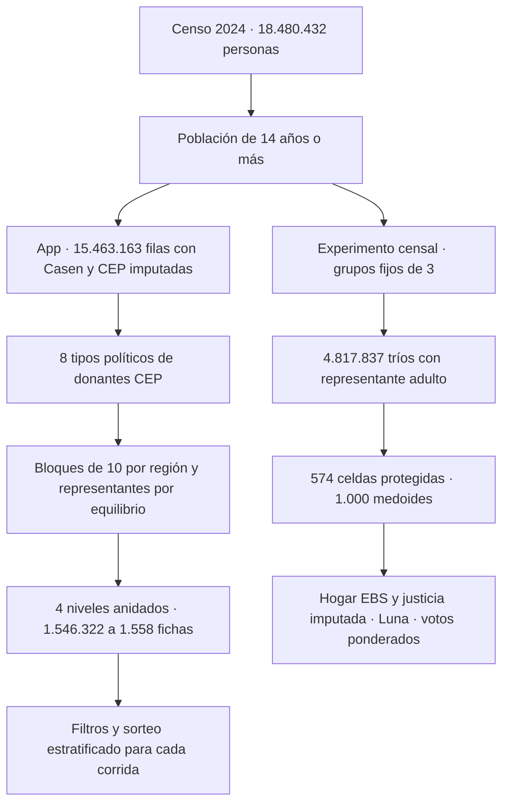

# De la población censal a los agentes de What If Chile

> **Dos rutas.** La reducción anidada (secciones «App») es la que usa el sitio. La investigación de los 1.000 arquetipos (tríos, celdas y medoides) se midió en un benchmark propio, con una de las más de 40 configuraciones que el equipo probó (GPT-6 Luna). El motor del sitio usa Claude Haiku con un analista Claude Opus que ancla el total nacional, y su validación en 82 preguntas reservadas (error medio 8,2 puntos, 88 % de mayorías acertadas) está en [VALIDACION.md](../../../VALIDACION.md).

Este documento describe el código y los datos de `main`, y reconstruye el catálogo de Luna validado en el benchmark de 111 preguntas. Hay dos rutas vigentes para dos usos distintos. **La app** sirve un catálogo nacional escalonado, con representantes elegidos para equilibrar proporciones. **El benchmark** consulta a 1.000 medoides censales de un catálogo experimental y pondera sus respuestas. Elegir 1.000 agentes en la interfaz y usar el catálogo de 1.000 de Luna son operaciones distintas.



## App · población de partida

El Censo 2024 registra **18.480.432 personas**. La población de la app contiene **15.463.163 de 14 años o más** y **6.596.527 hogares**. Los 3.017.269 menores de 14 quedan fuera como agentes individuales y siguen presentes en los atributos del hogar. Las 996.396 personas de 14 a 17 años entran en el universo de la app con actitudes políticas sin imputar. Los 14.466.767 adultos sí pueden recibirlas. El constructor une persona, hogar, vivienda y actitudes en `data/chile/chile.parquet`. [Constructor](../../scripts/construir_poblacion.py) · [Población completa](README.md) · [Validación de fuentes](validacion.md)

| Capa | Método | Por qué se usa |
| --- | --- | --- |
| Censo 2024 | Conserva las variables observadas, como edad, sexo, comuna, área, educación, actividad y hogar. Cuando la edad exacta está suprimida, se completa usando la distribución observada dentro de región, sexo y tramo quinquenal. | Ancla la composición demográfica y territorial al registro censal. |
| Casen 2024 | Imputa por donantes ponderados. Para hogares estima un ingreso tentativo con donantes comparables y disponibilidad comunal, y calibra el orden de ingresos en celdas regionales. Para personas usa celdas de sexo, edad, educación, actividad, ingreso y otros rasgos, que va ampliando cuando faltan donantes. | Introduce información económica y social preservando las combinaciones de un donante. |
| CEP N.º 96 | A cada adulto se le asigna un entrevistado ponderado en celdas de sexo, edad, educación, macrozona, nivel socioeconómico, actividad y religión, con niveles de relajación. Se copia el bloque de opiniones del mismo entrevistado. | Conserva combinaciones de opiniones que aparecen juntas en la encuesta. Cada donante puede aparecer muchas veces. |

La imputación produce una población compuesta de datos observados y prestados. La CEP tiene cobertura nacional y Casen da respaldo por región. Las correlaciones entre ingresos y opiniones, o las actitudes a escala comunal, siguen dependiendo del emparejamiento. [Implementación de Casen](../../scripts/construir_muestra.py) · [Implementación CEP](../../scripts/imputar_cep.py)

## App · cómo se crean los clusters

### 1. Ocho tipos políticos

El algoritmo trabaja sobre **1.466 donantes CEP distintos**, ponderados por cuántas personas de la población recibieron sus opiniones. Usa siete variables con pesos tomados del η² medio calculado en el análisis de influencia de la CEP.

| Variable | Peso |
| --- | ---: |
| Voto en segunda vuelta de 2025 | 9,4 |
| Aprobación del gobierno | 8,6 |
| Posición política | 8,0 |
| Confianza en el gobierno | 7,5 |
| Aprobación del gobierno anterior | 7,1 |
| Opinión sobre reducir el gasto público | 6,7 |
| Partido | 6,2 |

Cada categoría se convierte en una columna binaria y se multiplica por la raíz del peso. Se centra la matriz con los pesos de uso y se aplica **SVD ponderada** para proyectar las respuestas en cuatro ejes. Luego corre **k-means ponderado** con ocho grupos y doce inicializaciones. La función objetivo es minimizar la suma de las distancias euclídeas cuadradas al centro de cada grupo, multiplicadas por los usos de cada donante. Los grupos se numeran según su posición media sobre el eje principal y cada adulto hereda el tipo de su donante. El código conserva también el orden del donante en ese eje para formar bloques de perfiles parecidos. Los pesos resumen asociaciones de esa encuesta, por lo que su utilidad puede cambiar al estudiar otro tema o período. [Algoritmo](../../scripts/reducir_poblacion.py) · [Análisis de influencia](../metodo/influencia.md)

### 2. Bloques anidados por región

Dentro de cada región se ordenan las filas con una clave lexicográfica y se cortan en **bloques de hasta diez**. El primer nivel agrupa personas y cada nivel siguiente agrupa representantes del anterior. Al final de una región puede quedar un bloque menor. La región es una barrera fija. Comuna, zona y tipo político son prioridades del orden y un bloque puede cruzar sus límites cuando cae entre dos categorías.

| Nivel | Prioridad dentro de la región | Fichas |
| --- | --- | ---: |
| 1 por cada 10 | Comuna, zona, tipo político, sexo, tramo de edad, eje político y situación laboral | 1.546.322 |
| 1 por cada 100 | El mismo orden del primer nivel | 154.639 |
| 1 por cada 1.000 | Zona, tipo político, sexo, edad, eje, situación laboral y comuna | 15.474 |
| 1 por cada 10.000 | Tipo político, edad, sexo, eje, zona y situación laboral | 1.558 |

La elección de representante se hace con **equilibrio por déficits de categorías**. Al llegar a un bloque, se añade el peso de sus integrantes a los déficits de sus respectivas categorías. Se elige la fila cuya suma de déficits sea mayor y se descuenta de sus categorías el peso total del bloque. La elección ocurre de forma secuencial y usa desempates reproducibles. Entre los rasgos que equilibra están tipo político, voto, evaluación y confianza en el gobierno, posición política, sexo, tramo y quinquenio de edad, actividad, educación agrupada, presencia de niños, ingreso, zona, comuna y tipo de colegio. También incorpora los cruces sexo × edad y tipo político × edad.

Por ejemplo, si un bloque contiene seis fichas de una categoría y cuatro de otra, la segunda puede ser elegida si viene con mayor déficit acumulado. El representante recibe el peso de las diez. El objetivo es conservar proporciones regionales a través de muchos bloques. La ficha elegida conserva su perfil original y puede diferir de parte de las personas a las que representa. [Código y órdenes](../../scripts/reducir_poblacion.py) · [Informe generado](agentes.md)

### 3. Sorteo y voto en la app

1. El usuario elige nivel, filtros y tamaño de corrida. Se conservan las fichas con peso válido para ese nivel y cuyos atributos cumplen los filtros. El perfil del representante determina si su bloque entra al filtro.
2. Se estratifica por **región × comuna × zona**. Se reparten cupos según masa poblacional, con tope por disponibilidad. El redondeo controlado usa ciclos en una red de flujo para hacer enteras las cuotas sin romper las sumas territoriales objetivo, redondeadas dentro de su capacidad.
3. Dentro de cada estrato se elige sin reposición, en orden creciente de `−ln(Uᵢ) / pesoᵢ`. `Uᵢ` viene de un hash reproducible del ID y la semilla 2024. Un mayor peso tiende a adelantar la ficha. El servidor selecciona hasta la cantidad pedida o hasta agotar las fichas disponibles. Si falta la tabla o DuckDB, la ruta de respaldo usa un archivo fijo de 2.000 perfiles.
4. El peso se usa para construir el catálogo, el sorteo y el retrato poblacional. **El porcentaje de apoyo de la app se calcula contando un voto por agente que respondió**. Es una proporción de las fichas consultadas por ese diseño. El benchmark de Luna, descrito más adelante, suma pesos al agregar votos.

[Implementación del sorteo](../../servidor/poblacion.py) · [Cálculo del apoyo en el servidor](../../servidor/corridas.py) · [Conteo en el frontend](../../../frontend/src/vivo/useEnVivo.ts)

### Qué conserva la app

Se comprobó leyendo los 16 Parquet versionados que cada nivel suma exactamente **15.463.163 personas** y que las sumas coinciden entre niveles en **cada región**. Los tamaños nominales describen la escala. El peso verdadero de cada representante es la suma del peso de sus miembros.

| Indicador | 1 por 10 | 1 por 100 | 1 por 1.000 | 1 por 10.000 |
| --- | ---: | ---: | ---: | ---: |
| Coincidencia persona–representante en tipo político | 99,9% | 98,9% | 98,6% | 96,9% |
| Coincidencia persona–representante en comuna | 100,0% | 99,9% | 27,7% | 13,5% |
| Mayor desvío entre categorías de posición política | 0,01 pp | 0,05 pp | 0,19 pp | 0,39 pp |
| Mayor desvío entre categorías de educación detallada | 0,03 pp | 0,11 pp | 0,27 pp | 0,58 pp |
| Desvío medio de actitud dentro de los subgrupos evaluados | 0,06 pp | 0,34 pp | 1,13 pp | 4,43 pp |
| Comunas sin ficha | 0 | 0 | 11 | 68 |

Una buena distribución nacional puede coexistir con una mala aproximación para una persona, una comuna o un cruce pequeño. En el nivel 1 por 10.000, el promedio del desvío relativo de población por comuna para comunas de al menos 5.000 personas llegó a 28,0%. Los niveles finos son los que conservan mejor el detalle comunal, aunque el sorteo posterior puede dejar fuera estratos pequeños. El informe de origen describe los denominadores y el umbral mínimo de subgrupo. [Informe generado](agentes.md)

## Investigación · de los tríos a 1.000 arquetipos medoides

### 1. Primera compresión censal

El experimento de grupos fijos usó una regla de elegibilidad sobre el **Censo sin imputaciones**. En esa corrida entraron **15.461.128 registros**, con una diferencia respecto del universo de la app por el tratamiento de edades suprimidas. La firma preserva comuna, área, operativo censal, situación laboral y grupo ocupacional cuando aplica. La etapa estricta compara educación, edad quinquenal, tipo y tamaño de hogar, acceso a internet y dependencia económica. Entre dos ocupados también usa sector y movilidad laboral. Los desconocidos no cuentan como coincidencia. Se alcanza el mínimo de **80% de coincidencia por cada par** con al menos cinco de seis criterios o siete de ocho. La tenencia de vivienda y la presencia de menores quedaron fuera de esta firma.

Primero se forman grupos con coincidencia completa y luego se permiten omisiones sin bajar del umbral. Para los perfiles restantes se relajan las restricciones de forma sucesiva, desde el estrato original hasta una agrupación nacional de los remanentes. Se elige la firma con menor distancia total dentro del grupo y se exporta una fila censal de esa firma con peso tres o cinco, según el catálogo. La exportación mantiene columnas censales útiles para redactar el perfil, incluso si no intervinieron en el emparejamiento.

| Tamaño fijo | Grupos completos | Grupos con ≥80% y estrato común | Cobertura bajo ese criterio | Cohesión de todos los grupos | Silueta en la etapa estricta | Remanente |
| --- | ---: | ---: | ---: | ---: | ---: | ---: |
| 10 | 1.546.112 | 929.743 | 60,13% | 83,72% | 0,190 | 8 |
| 5 | 3.092.225 | 2.168.862 | 70,14% | 86,89% | 0,156 | 3 |
| 3 | 5.153.709 | 4.043.128 | 78,45% | 89,17% | 0,150 | 1 |

La cohesión es el promedio de coincidencias entre pares. La silueta aproxima la separación con hasta 2.000 integrantes de grupos estrictos y compara solo con otros grupos del mismo estrato. Más cobertura y cohesión favorecieron a los tríos. Los números de silueta muestran que estos grupos más parecidos por dentro también tenían vecinos muy próximos. El benchmark de Luna tomó **4.817.837 tríos cuyo representante tenía 18 años o más**. Cada trío mantiene peso tres, para una masa de **14.453.511 personas**. El corte se aplica al representante, por eso esa masa difiere del total adulto censal y no acredita la edad de cada miembro del trío. [Agrupador y métricas](../../scripts/agrupar_catalogo.py) · [Exportador](../../scripts/exportar_catalogo.py)

### 2. Segunda compresión con medoides

1. Se construyen celdas de **región × zona × tramo de edad × educación**. El catálogo elegido subdivide las de la RM según transporte laboral. Para esa subdivisión, el código distingue medio censal 1, medio 2 y resto. El medio laboral es una aproximación a la exposición al TAG. Esta variante produjo **574 celdas**.
2. Cada celda no vacía recibe al menos un cupo y se distribuyen los otros cupos por el número de tríos, con mayores restos y un tope de capacidad. Se ordenan las filas por sus rasgos e ID y se cortan en tantos bloques contiguos como cupos recibió la celda. Cada trío queda asignado una vez.
3. Dentro de cada bloque se elige el **medoide**, una ficha existente que minimiza su distancia sumada a los demás miembros. La distancia agrega una unidad por diferencia en comuna, sexo, situación laboral, ocupación, transporte y tipo de hogar, más la diferencia entre edades quinquenales dividida por 70. Se desempata por cercanía al centro ordinal del bloque. Es una búsqueda local de representante con una distancia para datos mixtos. La partición ya está fijada por las celdas y el orden.
4. El peso bruto es `3 × número de tríos del bloque`. Los **1.000 medoides se generaron directamente desde los tríos**, con asignación de cupos para ese tamaño. Se usó el catálogo completo en las 111 preguntas, con 40 lotes de 25 por pregunta. El plan usó sus pesos brutos.

Las alternativas ensayadas incluyen la ficha central del bloque, medoides con las celdas básicas y medoides con transporte protegido en la RM. Antes se probaron catálogos de bloques de 250.000, 500.000 y 1.000.000, tomando muestras de 2.000, 5.000 y 10.000. En el experimento de una sola pregunta del TAG, al evaluar 10.000 fichas completas y ajustar con IPF demográfico, el error medio de apoyo y rechazo fue **6,49 pp** con bloques, **5,62 pp** con medoides y **5,54 pp** con medoides con transporte protegido. Esa comparación orienta la elección del catálogo. Cada tamaño y cada política requieren su propia validación. [Bloques y cuotas](../../scripts/preparar_benchmark_catalogos.py) · [Medoides y prueba del TAG](../../scripts/benchmark_neyman_catalogos.py) · [Pregunta de Cadem, p. 23](https://cadem.cl/wp-content/uploads/2026/10/Track-PP-698-Octubre-S3-M1-VF.pdf)

### 3. Enriquecimiento y agregación

Sobre cada medoide se añade un donante de la **Encuesta de Bienestar Social 2023** para obtener tres valores conjuntos: dificultad de fin de mes, capacidad de cubrir tres meses de gastos básicos sin ingresos y deuda no hipotecaria. La búsqueda empieza por región, edad, educación, situación laboral y sexo. Si no hay una celda con al menos 15 donantes efectivos, usa reglas progresivamente más amplias. El sorteo usa los pesos de la encuesta y una semilla derivada del ID. Al mismo perfil se le asigna uno de dos criterios de justicia distributiva con el mismo generador reproducible. Es una imputación experimental cuya prevalencia poblacional queda por estimar. Esta etapa complementa la ficha después de elegir los grupos, y mantiene los pesos.

Cada arquetipo responde como una persona. En el benchmark se calcula el porcentaje de la categoría como **100 × suma de pesos de las fichas en la categoría ÷ suma de pesos del universo evaluado**. Así, una ficha de peso 300 y otra de peso 700 aportan 30% y 70% de la masa en ese ejemplo. Esa expansión supone que la postura del representante aproxima la de su grupo. Las 111.000 respuestas son simuladas. Para las cuatro preguntas del Ministerio del Medio Ambiente se calculó además un agregado urbano con 665 fichas y pesos renormalizados. [Preparación del perfil](../../scripts/benchmark_asociaciones.py) · [Informe de Luna](../modelo-luna-postura-explicita.md) · [JSON y metodología de los 111 casos](../../../datos-pruebas/benchmark-politicas-chile.json)

### Qué conserva el catálogo de 1.000

La masa y los cruces que definen una celda se preservan respecto de los tríos de origen. Comparar con el Censo adulto permite detectar desviaciones acumuladas desde la primera reducción. La **distancia de variación total (TV)** equivale a la mitad de la suma de diferencias absolutas entre proporciones, expresada en puntos porcentuales.

| Comparación contra el Censo adulto | TV |
| --- | ---: |
| Región × zona | 0,01 pp |
| Tramo de edad × educación | 2,08 pp |
| Sexo | 8,38 pp |
| Situación laboral | 8,23 pp |
| Región × transporte laboral | 19,79 pp |
| Comuna | 33,98 pp |
| Tipo de hogar | 34,64 pp |

El peso mediano fue de **13.534,5** personas y el máximo **32.082**. El tamaño efectivo de Kish, `(Σ peso)² / Σ peso²`, fue **651** sobre 1.000 fichas. Resume la concentración del peso y no mide la incertidumbre del LLM ni el tamaño de una muestra probabilística. En el benchmark de 111 preguntas, Luna obtuvo **12,19 pp de error medio** entre apoyo, rechazo e indecisión y coincidió con el lado más votado en **95/109**. Son métricas de una corrida que combina catálogo, texto, contexto y modelo. La fidelidad territorial o demográfica por sí sola no indica si el sistema estima bien una opinión. [Resultados y método](../../../datos-pruebas/contexto-benchmark-luna.md)

## Dónde entran IPF, Neyman y las métricas de calidad

- **IPF** recalibra el peso después de construir un catálogo o extraer una muestra. Ajusta alternativamente región, zona, edad, educación, sexo y situación laboral a los márgenes del Censo adulto. El código limita el ajuste a entre 0,2 y 5 veces el peso base durante la iteración y devuelve un diagnóstico si falta soporte o no converge. Los pesos de las 111 preguntas de Luna son los pesos brutos del catálogo de 1.000.
- **Neyman** redistribuye cupos de una muestra estratificada según `masa del estrato × dispersión estimada de la variable de apoyo`. En el TAG se usó una dispersión suavizada de un piloto anterior. Se comparó con cuotas proporcionales, con y sin un piso de 500 fichas de auto en la RM. Las 100 repeticiones de 5.000 fichas reutilizaron decisiones de Luna del catálogo de 10.000. En la variante de medoides con transporte protegido, el piso redujo el RMSE de apoyo en ese subgrupo de **1,49 a 0,93 pp** frente al resultado simulado del catálogo completo. El error nacional contra Cadem se mantuvo cerca de 5,55 pp. Para esas muestras se usó `peso de la ficha × fichas del estrato / cupo`, y se evaluó aparte la opción de recalibrar con IPF.
- **Cohesión, silueta, TV y error de encuesta** responden preguntas distintas. La cohesión y la silueta describen los grupos. La TV mide composición ponderada. El error de encuesta compara las decisiones simuladas con apoyo, rechazo e indecisión publicados. Coresets y cadenas de Markov quedan fuera de estos dos flujos. Una transición de Markov necesitaría observaciones temporales adecuadas para estimar probabilidades de cambio.

[Implementación de IPF](../../scripts/preparar_benchmark_catalogos.py) · [Diseños de muestreo](../../scripts/benchmark_neyman_catalogos.py)

## Reproducción y auditoría

Para la app, las instrucciones de construcción y validación de los insumos se encuentran en el [README de población](README.md). Para regenerar los niveles sin tocar la tabla que consume el servidor, usar directorios separados. La reducción escribe también su informe de composición.

```bash
cd backend
uv run python -I scripts/reducir_poblacion.py data/chile data/agentes-auditoria contexto/auditoria-reduccion
```

Para Luna se necesita el Censo en Parquet y el catálogo de tríos local. Desde la raíz, el primer comando genera el catálogo de 1.000 y el segundo produce el plan con EBS y justicia. En `--datos` se indica la carpeta que contiene `agentes_trios/region_*.parquet`. El informe del modelo describe cómo ejecutar el plan con acceso a Luna.

```bash
uv run --project backend python backend/scripts/benchmark_neyman_catalogos.py preparar \
  --personas RUTA_PERSONAS_PARQUET --hogares RUTA_HOGARES_PARQUET \
  --datos RUTA_DATOS_CON_TRIOS --agrupaciones medoides_transporte \
  --arquetipos 1000 --muestra 1000 --salida SALIDA_CATALOGO_1000

uv run --project backend python backend/scripts/benchmark_asociaciones.py preparar \
  --origen SALIDA_CATALOGO_1000 --ebs RUTA_MICRODATOS_EBS --salida SALIDA_PLAN_LUNA
```

El comando `exportar_catalogo.py` permite reconstruir la base `agentes_trios` a partir de los Parquet de personas, hogares y viviendas con `--tamano 3`. Para verificar una reproducción, registrar la revisión del código, el universo y sus filtros, las semillas, los recuentos y pesos por nivel, la huella del plan y las tasas por categoría. En esta revisión se cotejaron los IDs y pesos de los 1.000 medoides con el manifiesto archivado y la huella SHA-256 del plan con la publicada en el JSON. [Exportación de tríos](../../scripts/exportar_catalogo.py) · [Ejecución y verificaciones de Luna](../modelo-luna-postura-explicita.md)
