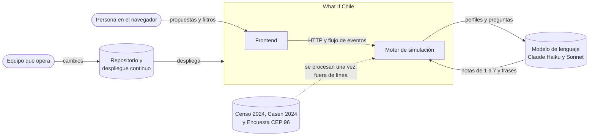
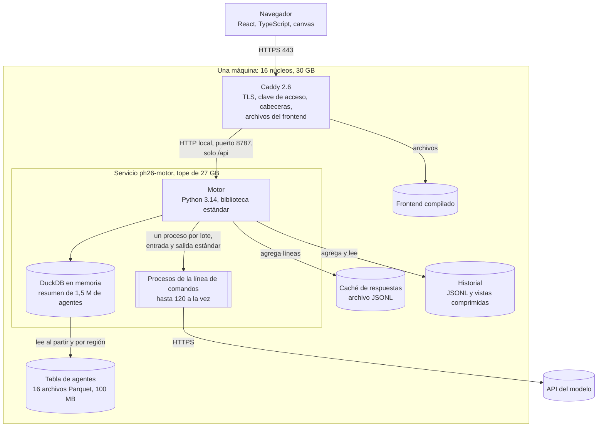
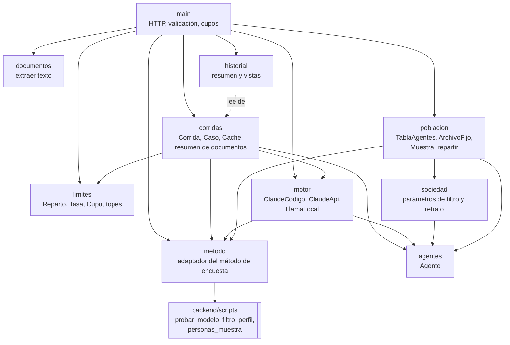

# 2. Arquitectura

[Índice](README.md)

## 2.1 Estilo y justificación

**Características que mandan.** De las que podían pesar (simplicidad, tiempo de respuesta percibido,
costo, capacidad de absorber ráfagas, facilidad de despliegue, tolerancia a fallas, facilidad de
cambio), las tres principales son:

1. **Simplicidad y facilidad de cambio.** Un equipo de cinco personas en un fin de semana tenía que
   poder leer todo el servidor y cambiarlo sin romper el método de encuesta.
2. **Tiempo de respuesta percibido** (RNF-01, RNF-02). La demo se gana cuando el mapa empieza a
   encenderse a los pocos segundos.
3. **Capacidad de absorber ráfagas sin caerse** (RNF-05, RNF-09). El sitio puede abrirse al
   público durante la presentación.

**Estilos evaluados.**

| Característica | Un proceso con trabajo en hilos (elegido) | API más cola y trabajadores aparte | Funciones sin servidor |
|---|---|---|---|
| Simplicidad | Alta: un proceso, un lenguaje, sin intermediarios | Media: dos despliegues, una cola y su monitoreo | Media: muchas piezas administradas |
| Tiempo percibido | Alto: el evento sale del mismo proceso que recibe la respuesta | Medio: un salto más entre trabajador y navegador | Bajo: arranque en frío y sin flujo de eventos largo |
| Ráfagas | Medio: el tope es la máquina; se resuelve con cupos | Alto: la cola absorbe y los trabajadores escalan | Alto |
| Restricción dura | Ninguna | Ninguna | El modelo se llama por una línea de comandos con sesión local: no corre en una función |

**Elegido:** un solo proceso de Python que atiende HTTP y ejecuta las simulaciones en hilos, detrás
de un servidor web que termina TLS y sirve el frontend. Hay dos unidades desplegables: Caddy, que es
la frontera con internet, y el motor.

- **Aporta:** todo el estado de una simulación está en un solo lugar, el flujo de eventos es
  directo, se despliega con un `git pull` y no hay infraestructura que mantener además de la máquina.
- **Empeora:** el estado en memoria se pierde al reiniciar (S-02), no escala a más de una máquina
  sin cambios (RT-01) y el techo de capacidad es el de esa máquina y esa suscripción. Es aceptable
  porque la carga esperada es una sala (S-01) y los topes impiden que el exceso bote el proceso.

**Condiciones que obligarían a revisar la decisión:** más de una máquina, simulaciones que deban
sobrevivir a un reinicio, o un volumen sostenido sobre unas 90 respuestas por segundo. El camino en
ese caso está en el [documento 7](07-capacidad-y-escalado.md), sección 7.6, y en el ADR-01.

## 2.2 Contexto

La persona escribe propuestas y elige a quiénes preguntar. El motor arma la muestra, le entrega al
modelo el perfil de cada persona con la propuesta y la encuesta, y devuelve las respuestas al
navegador a medida que llegan. Las fuentes de datos no se consultan en línea: se procesaron antes y
quedaron como archivos de agentes dentro del repositorio. Lo único externo en tiempo de ejecución es
el modelo de lenguaje.

## 2.3 Contenedores

- **Caddy** es la única puerta: termina TLS, pide la clave de acceso si está configurada, agrega las
  cabeceras de seguridad, limita el tamaño de lo que se sube y manda `/api/*` al motor. Lo demás lo
  responde con el frontend compilado.
- **El motor** escucha solo en la interfaz local. No hay base de datos aparte: los agentes se
  consultan con DuckDB dentro del mismo proceso y lo que persiste son archivos a los que solo se les
  agregan líneas.
- **Los procesos de la línea de comandos** son hijos del motor: uno por cada lote de personas. Son
  lo más caro del sistema, en memoria y en procesador, y por eso tienen un tope común.

## 2.4 Módulos del motor

| Módulo | Responsabilidad | No hace |
|---|---|---|
| `__main__.py` | Rutas HTTP, validación de cada pedido, cupos de admisión, flujo de eventos | No sabe cómo se pregunta al modelo |
| `limites.py` | El reparto de llamadas entre simulaciones, la tasa por dirección y los topes configurables | No conoce las simulaciones ni HTTP |
| `corridas.py` | Una simulación de principio a fin: lotes, frases, iteraciones, eventos, caché | No habla HTTP ni arma perfiles |
| `motor.py` | Un motor por proveedor con la misma interfaz: responder, comentar, redactar | No decide a quién preguntar ni cuándo |
| `metodo.py` | Importa del banco de pruebas las instrucciones, la encuesta y el redactor de perfiles | No copia el método: lo usa |
| `poblacion.py` | Filtrar, sortear con cuotas y armar agentes; guarda muestras ya pedidas | No conoce la encuesta |
| `sociedad.py` | Cada parámetro de filtro definido una sola vez: opciones, SQL y lectura desde un perfil | |
| `agentes.py` | La persona simulada y lo que de ella viaja a la interfaz | |
| `documentos.py` | De un archivo subido a texto, con topes | No resume |
| `historial.py` | Resumen de cada simulación y su vista completa para volver a verla | |

La dependencia más delicada es `metodo.py`: carga módulos de `backend/scripts/` por ruta. Si allá
cambia una firma, el servidor no arranca, y por eso el despliegue comprueba que responda antes de
dar por bueno el cambio ([documento 8](08-operacion.md)).

## 2.5 Patrones

| Problema | Patrón | Nivel | Por qué y cuándo dejaría de servir |
|---|---|---|---|
| Varios proveedores de modelo con el mismo uso | Estrategia: `Motor` con `ClaudeCodigo`, `ClaudeApi` y `LlamaLocal` | Diseño | Una corrida no sabe quién responde. Deja de servir si un proveedor necesita un protocolo distinto, como respuestas en flujo |
| El método de encuesta vive en otro paquete y cambia seguido | Adaptador: `metodo.py` | Diseño | Evita dos copias que se desalinean. Si el método se publicara como paquete, se importaría directo |
| Muchas simulaciones compiten por pocas llamadas al modelo | Grupo de trabajadores con turnos por dueño: `Reparto` | Arquitectura | Da un tope global y equidad. Con más de una máquina se reemplaza por una cola externa |
| El navegador debe ver cada respuesta apenas llega | Registro de eventos con flujo del servidor al navegador y reanudación por número de evento | Arquitectura | Simple y con reconexión nativa. Con varias máquinas el registro tendría que salir del proceso |
| Repetir una pregunta no debe volver a gastar | Caché de solo agregar con clave por contenido | Arquitectura | El archivo crece sin compactarse y se carga entero al partir; sirve mientras quepa en memoria |
| Exceso de pedidos | Control de admisión: cupos y tasas que rechazan con mensaje en vez de encolar sin límite | Arquitectura | Protege al proceso. No reemplaza a un control en el borde si hubiera un ataque distribuido |
| Un lote falla por límite del proveedor | Reintento con espera creciente y aleatoria, hasta 3 intentos | Diseño | Evita insistir en ráfaga. Si el proveedor informa cuánto esperar, convendría usar ese valor |

## 2.6 Concurrencia

El motor usa hilos, no procesos ni asincronía. Los hilos pasan casi todo su tiempo esperando a un
proceso hijo o a la red, así que el intérprete no es el cuello de botella.

| Hilos | Cuántos | Qué hacen |
|---|---|---|
| De conexión | Uno por conexión abierta, hasta 800 | Atienden un pedido o mantienen un flujo de eventos |
| Del reparto | Hasta `LLAMADAS` (120 en producción), creados a medida que hacen falta | Ejecutan una llamada al modelo cada uno |
| De simulación | Uno por simulación en curso, hasta 40 | Encola lotes, espera resultados, redacta iteraciones y guarda el historial |
| De reproducción | Uno por caso que sale de la caché | Entrega lo guardado en tandas durante 6 segundos |

Estado compartido y cómo se protege:

| Estado | Protección |
|---|---|
| Simulaciones en curso y su origen (`CORRIDAS`, `ORIGEN`, `FLUJOS`) | `CERROJO_CORRIDAS` para las escrituras, las comprobaciones de cupo y el alta, que ocurren juntas. Las lecturas puntuales (buscar una simulación por su identificador) van sin cerrojo |
| Muestras guardadas (`MUESTRAS`) | `CERROJO_MUESTRAS` |
| Eventos de una simulación | Una condición por simulación: quien publica avisa y quien transmite espera |
| Respuestas y consumo de una simulación | Un cerrojo por simulación |
| Colas del reparto | Una condición del reparto; tomar una tarea y descartar una cola son atómicos entre sí |
| Caché de respuestas | Un cerrojo para guardar, con la escritura del archivo dentro; las búsquedas leen sin cerrojo |
| Historial | Un cerrojo propio para la lista de resúmenes y la de vistas |
| Tasas por dirección | Un cerrojo por cada tasa |
| Perfiles filtrados ya escritos | Un cerrojo en `metodo.py` |
| Conexión a DuckDB | Un cerrojo: las consultas a la tabla van de a una |

No hay cerrojos anidados entre módulos, salvo `CERROJO_CORRIDAS` seguido de la lectura sin cerrojo
de contadores de cada simulación, que no puede bloquear.

## 2.7 Despliegue y ambientes

Hay dos ambientes: local y producción.

| | Local | Producción |
|---|---|---|
| Arranque | `./iniciar.sh` levanta el motor y Vite con su proxy a `/api` | Servicio de systemd y Caddy |
| Modelo | El que esté disponible: modelo local, API o línea de comandos | Línea de comandos con una o más sesiones |
| Datos | La misma tabla de agentes del repositorio | La misma |
| Topes | Los por defecto | Los del servicio y del archivo de entorno de la máquina |

Producción es una instancia `c7i.4xlarge` (16 núcleos, 30 GB útiles, disco de 30 GB) con Ubuntu
24.04, creada con Terraform (`infra/main.tf`). Solo tiene abiertos los puertos 22, 80 y 443. Cada
push a `main` dispara el despliegue; el detalle está en el [documento 8](08-operacion.md).
