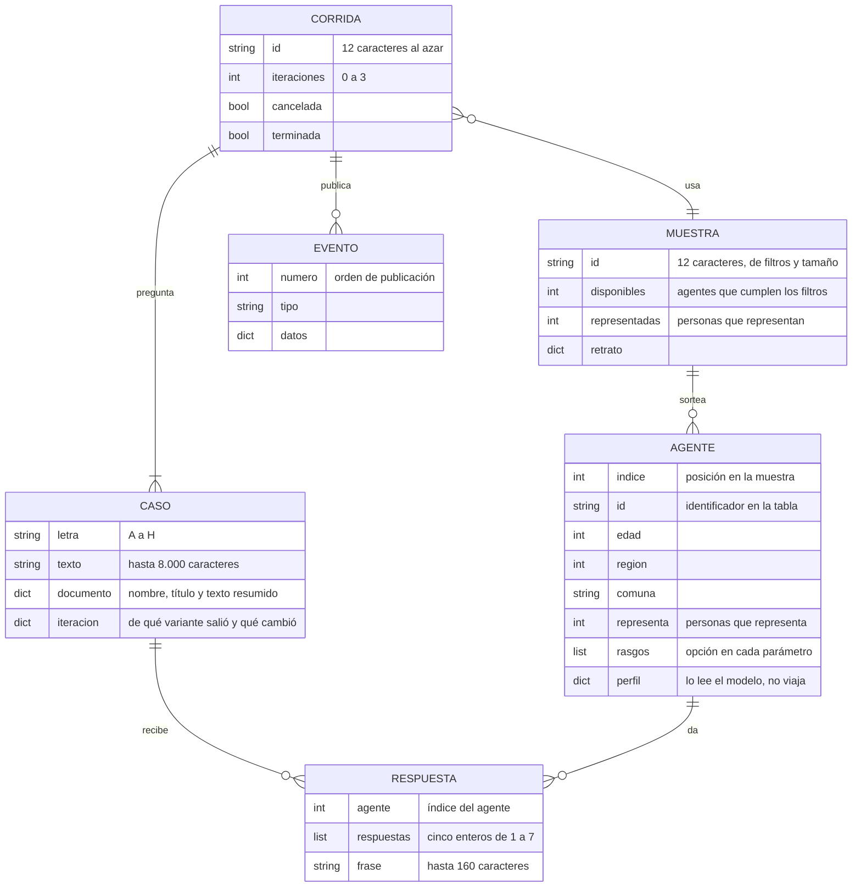
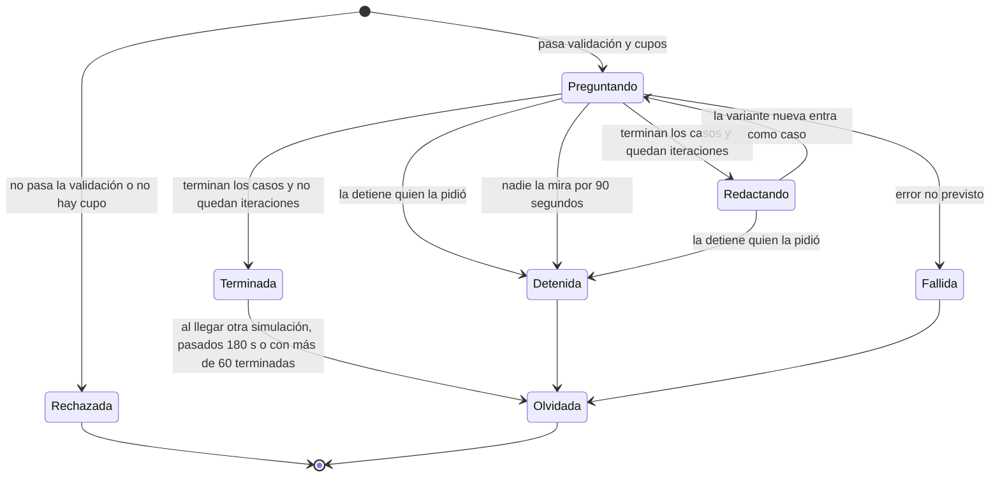

# 3. Dominio y datos

[Índice](README.md)

## 3.1 Lenguaje del dominio

| Término | Significado | Nombre en el código |
|---|---|---|
| Agente | Una persona simulada: un registro real y anónimo del Censo 2024, con datos de Casen y opiniones de la CEP imputados. Representa a un grupo de personas parecidas | `Agente` |
| Nivel de reducción | A cuántas personas representa cada agente: 10, 100, 1.000 o 10.000. Los niveles son anidados | `reduccion`, columnas `representa*` |
| Perfil | El texto que describe a la persona y que lee el modelo, en nueve secciones | `Agente.perfil`, `metodo.perfil_de` |
| Perfil filtrado | La parte del perfil que se entrega para una política: un núcleo de 28 datos más los de los temas que toca el texto | `metodo.datos_de` |
| Parámetro | Una característica por la que se filtra y se analiza: región, género, educación y otras diez | `sociedad.PARAMETROS` |
| Rasgos | La opción de un agente en cada parámetro, como lista de enteros (menos uno si no tiene el dato) | `Agente.rasgos`, campo `s` |
| Muestra | Los agentes sorteados para un filtro y un tamaño, con su retrato | `Muestra` |
| Retrato | Por parámetro, cuántas personas hay en cada opción entre quienes cumplen los demás filtros | `Muestra.retrato` |
| Simulación o corrida | Una encuesta hecha a una muestra para una o más variantes | `Corrida` |
| Variante o caso | Una versión de la política dentro de una simulación, identificada con una letra | `Caso` |
| Iteración | Una variante que redacta el modelo a partir de las objeciones a la mejor variante | `Caso.iteracion` |
| Lote | Un grupo de personas que el modelo responde en una sola llamada (10 en producción) | `LOTE`, `Corrida._lote` |
| Respuesta | Las cinco notas de 1 a 7 de un agente a un caso, y su frase si se le pidió | `Respuesta` |
| Postura | A favor, sin decidir o en contra, según la primera nota | `corridas.postura` |
| Frase o voz | La explicación en primera persona de una respuesta ya dada | `Respuesta.frase`, evento `voces` |
| Huella | Resumen de 20 caracteres del texto de una política, que la identifica en la caché | `Cache.huella` |

## 3.2 Entidades y relaciones

Invariantes y dónde se garantizan:

| ID | Invariante | Dónde |
|---|---|---|
| I-01 | Una respuesta tiene exactamente cinco enteros entre 1 y 7; cualquier otra cosa se descarta | `motor.notas_validas` |
| I-02 | Cada agente tiene a lo más una respuesta por caso | `Caso.respuestas`, diccionario por índice |
| I-03 | Los agentes de una simulación son únicos y pertenecen a la muestra indicada | `__main__._crear_corrida` |
| I-04 | Una simulación no pide más respuestas que `RESPUESTAS_POR_CORRIDA` | `__main__._crear_corrida` |
| I-05 | El número de un evento no cambia una vez publicado: la lista solo crece | `Corrida.publicar` |
| I-06 | Una respuesta en caché corresponde a la misma política, el mismo agente, el mismo modelo y las mismas instrucciones | `Cache`, `Motor.clave` |
| I-07 | Lo que viaja a la interfaz de un agente no incluye su perfil | `Agente.publico` |

## 3.3 Estados de una simulación

- **Terminada** publica el evento `fin` y guarda su resumen y su vista en el historial.
- **Detenida** también publica `fin`, con lo que alcanzó a responderse; guarda el resumen marcado
  como incompleto y no guarda vista.
- **Fallida** publica `falla` con un mensaje genérico; el detalle queda en el registro del servidor.
  Si alcanzó a haber respuestas, guarda resumen y vista, con el evento `falla` incluido.
- **Olvidada** significa que salió de la memoria. Si quedó en el historial se puede volver a ver.

En los tres casos el historial se escribe solo si hubo al menos una respuesta.

El olvido no tiene temporizador: se revisa cada vez que llega una simulación nueva. Ahí salen de la
memoria las terminadas hace más de 180 segundos y, si aun así quedan más de 60, las más antiguas.
Sin simulaciones nuevas, las terminadas siguen en memoria, acotadas por esos mismos topes en cuanto
llegue la siguiente.

Un lote que falla tres veces no cambia el estado de la simulación: se publica un `aviso` y esas
personas quedan sin respuesta en ese caso.

## 3.4 Qué se guarda y dónde

| Dato | Dónde | Tamaño | Retención | Se versiona |
|---|---|---|---|---|
| Tabla de agentes | `backend/data/agentes/region_NN.parquet` | 100 MB, 1.546.322 filas | Fija; se regenera con los scripts de población | Sí |
| Resumen de rasgos | Memoria del motor (DuckDB) | Una fila por agente; se arma al partir en 0,3 s | Vida del proceso | No |
| Agentes ya armados | Memoria | Hasta 30.000 | Vida del proceso, se reemplazan los menos usados | No |
| Muestras pedidas | Memoria | Hasta 60 | Vida del proceso, se reemplazan las menos usadas | No |
| Perfiles filtrados | Memoria | Hasta 60.000 | Vida del proceso | No |
| Simulaciones | Memoria | En curso: hasta 40. Terminadas: hasta 60, por al menos 180 s | Hasta que se olvidan, al llegar una simulación nueva | No |
| Caché de respuestas | `backend/data/cache/respuestas.jsonl` | Unos 110 bytes por respuesta. Al partir se carga entero en memoria; sobre 3 millones de filas no se recuerdan filas nuevas | Sin vencimiento; se invalida sola si cambian las instrucciones, la encuesta o el filtro de perfil | No |
| Resumen de simulaciones | `backend/data/historial/corridas.jsonl` | Una línea por simulación; en memoria las últimas 2.000 | Sin vencimiento | No |
| Vistas para volver a ver | `backend/data/historial/vistas/<id>.json.gz` | 100 KB a 1 MB cada una | Las últimas 200 | No |
| Frontend compilado | `/var/www/ph26` en la máquina | Pocos MB | Se reemplaza en cada despliegue | No |

Volumen esperado: una simulación de 10.000 agentes agrega cerca de 1,1 MB a la caché. Con el disco
de 30 GB y 24 GB libres, el archivo de caché no es un riesgo en el plazo del proyecto; no tiene
compactación ni rotación (RT-05).

**Respaldos.** No hay. Lo que no se puede reconstruir es la caché (cuesta volver a preguntar) y el
historial. La tabla de agentes está en el repositorio. Para este proyecto se acepta; si el sitio
siguiera en uso, lo primero sería copiar `backend/data/cache` y `backend/data/historial` a un
almacenamiento externo cada noche.

## 3.5 Datos personales

- Los agentes son registros anonimizados que publica el INE; no hay nombres ni direcciones, y la
  geografía llega solo hasta comuna y zona urbana o rural.
- Las opiniones y los ingresos de cada agente son imputados: valores plausibles tomados de una
  persona parecida de una encuesta, no datos de esa persona.
- El sistema no pide cuenta ni guarda quién preguntó. Lo único que queda de una persona real es el
  texto que escribió, que entra al historial común y lo ve cualquiera con acceso al sitio (S-03,
  RT-04).
- La dirección de red de quien pide se usa en memoria para las tasas por dirección y no se escribe
  en disco. El registro del servidor web sí puede contenerla.
- Al modelo de lenguaje viajan el texto de la propuesta y perfiles de agentes. No viaja nada de quien
  usa el sitio.

Al publicar resultados se citan las fuentes: INE, Censo de Población y Vivienda 2024; Ministerio de
Desarrollo Social, Casen 2024; Centro de Estudios Públicos, Encuesta CEP N° 96.
