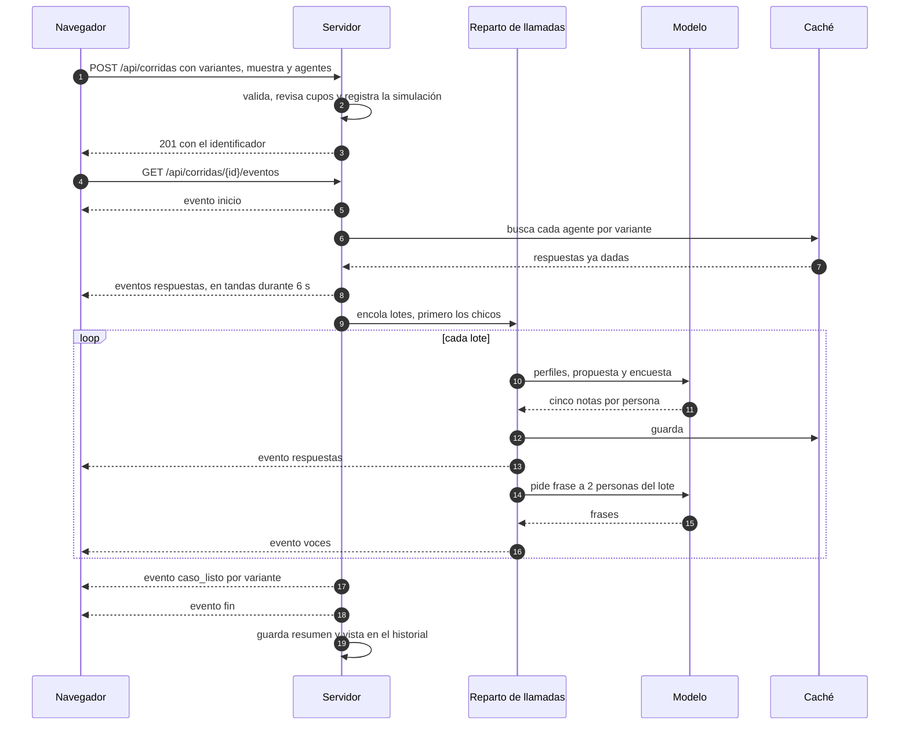

# 4. Flujos de punta a punta

[Índice](README.md)

Cada flujo dice quién lo inicia, qué pasa en cada paso, qué se observa al final y qué ocurre cuando
algo falla. Los números de paso son estables: se pueden citar como "F3, paso 5".

| Flujo | Qué hace | Requisitos |
|---|---|---|
| [F1](#f1-abrir-el-sitio) | Abrir el sitio y saber qué hay disponible | RF-01 |
| [F2](#f2-elegir-a-quiénes-preguntar) | Elegir a quiénes preguntar | RF-02, RF-03 |
| [F3](#f3-simular-una-propuesta) | Simular una propuesta | RF-04, RF-05, RF-08 |
| [F4](#f4-iterar-la-propuesta) | Iterar la propuesta | RF-06 |
| [F5](#f5-subir-un-documento) | Subir un documento | RF-07 |
| [F6](#f6-detener-una-simulación) | Detener una simulación | RF-09 |
| [F7](#f7-volver-a-ver-una-simulación) | Volver a ver una simulación | RF-10 |

## F1. Abrir el sitio

Actor: cualquier persona. Disparador: abre la dirección del sitio.

1. Caddy entrega el frontend, sin pedir usuario ni clave.
2. El navegador pide `GET /api/estado`. Recibe el motor y el modelo que responden, cuántos agentes y
   personas hay, los niveles de reducción, los parámetros de filtro con sus opciones, la encuesta
   con sus escalas y el máximo de agentes por simulación.
3. El navegador pide la muestra inicial (F2) y el historial (F7, paso 1).

Resultado observable: el mapa dibuja a los agentes de la muestra inicial y la esquina dice qué
modelo responde.

Errores:

- 2a. El motor no responde en 2,5 segundos: la interfaz pasa a su demostración local, que sortea
  respuestas en el navegador y lo dice en pantalla. No se compara con encuestas reales.

## F2. Elegir a quiénes preguntar

Actor: cualquier persona. Disparador: cambia un filtro o el tamaño de la muestra.

1. El navegador envía `POST /api/muestra` con los filtros (rango de edad, nivel de reducción y, por
   parámetro, las opciones elegidas) y el tamaño.
2. El motor normaliza los filtros: descarta lo que no es un entero válido y lo que no filtra nada.
3. Si esa combinación ya se pidió, devuelve la muestra guardada.
4. Si no, consulta el resumen de rasgos: cuenta por región, comuna y zona a quienes cumplen, calcula
   la cuota de cada estrato con redondeo controlado, sortea dentro de cada estrato en proporción a
   las personas que representa cada agente, y arma el perfil de los que no estaban ya armados.
5. Calcula el retrato: para cada parámetro, cuánta gente hay en cada opción entre quienes cumplen
   los demás filtros.
6. Guarda la muestra y la devuelve con su identificador.

Resultado observable: el contador de la interfaz muestra cuántas personas cumplen, cada filtro
muestra cuánta gente suma o quita cada opción, y el mapa mueve los puntos. En el servidor queda la
muestra guardada bajo su identificador.

Errores:

- 1a. Más de 600 pedidos por minuto desde la misma dirección: 429 con mensaje.
- 4a. Ya hay 12 muestras nuevas esperando la tabla: 429 con mensaje para reintentar.
- 4b. Ningún agente cumple los filtros: se devuelve una muestra vacía; la simulación posterior se
  rechaza con "La muestra quedó vacía".

Tiempo medido: 0,3 segundos con 2.000 agentes y 1 segundo con 10.000 la primera vez; inmediato si
se repite.

## F3. Simular una propuesta

Actor: cualquier persona. Disparador: aprieta el botón de preguntar. Precondición: una muestra
vigente (F2).

1. El navegador envía las variantes (texto y, si hay, documento ya leído), el identificador de la
   muestra, los índices de los agentes elegidos, la cantidad de iteraciones y los filtros de la
   interfaz.
2. El servidor valida cada campo y comprueba los cupos (detalle en el [documento 5](05-api.md),
   sección 5.4). Si pasa, registra la simulación y lanza su hilo.
3. Responde 201 con el identificador.
4. El navegador abre el flujo de eventos de esa simulación.
5. El servidor publica `inicio` con las variantes, los temas que el filtro de perfil detectó en cada
   texto y la encuesta.
6. Por cada variante, separa a los agentes que ya tienen respuesta en la caché de los que no.
7. Lo que estaba en caché se entrega en tandas repartidas en 6 segundos, para que el mapa igual se
   vea encender.
8. Lo pendiente se parte en lotes. Si hay muchos agentes, los primeros 64 van en lotes chicos (24
   personas de a 2 y 40 de a 5) y con prioridad: responden en 3 a 5 segundos y dan las primeras
   respuestas. El resto va en lotes de 10.
9. Cada lote espera su turno en el reparto común. Cuando le toca, el motor arma el mensaje de
   sistema (instrucciones, propuesta y encuesta con sus escalas) y el mensaje con el perfil filtrado
   de cada persona, y llama al modelo.
10. De la respuesta se aceptan solo filas con un índice válido y cinco enteros de 1 a 7. Si faltó
    alguien, se le vuelve a preguntar una vez solo a esas personas.
11. Las respuestas se guardan en la caché y se publica `respuestas` con las notas y las métricas
    acumuladas.
12. A dos personas del lote (una a favor y una que no) se les pide una frase en una llamada aparte,
    hasta 30 veces por variante. Llega como evento `voces`.
13. Al completarse una variante se publica `caso_listo` con su apoyo.
14. Al completarse todas, si no hay iteraciones, se publica `fin`, se guarda el historial y la
    simulación queda disponible al menos 180 segundos para quien reconecte.

Resultado observable: cada punto del mapa toma el color de su postura cuando llega su respuesta; al
final quedan los porcentajes por variante, el resultado de cada pregunta y las frases. En el
servidor quedan las respuestas en la caché y la simulación en el historial.

Errores y alternativas:

- 2a. Un campo no pasa la validación: 400 con un mensaje para la persona.
- 2b. No hay cupo (simulaciones en curso, respuestas en cola o pedidos por minuto): 429 con mensaje.
- 2c. La muestra ya no está guardada: 400 "vuelve a elegir a quiénes preguntar".
- 4a. La simulación ya se olvidó: 404.
- 4b. Se corta la conexión: el navegador reconecta solo y envía el número del último evento
  recibido; el servidor continúa desde el siguiente.
- 9a. La llamada falla o vence a los 150 segundos: se hacen hasta 3 intentos, esperando cada vez
  más entre uno y otro. Si falla el tercero, se publica `aviso` y esas personas quedan sin respuesta.
- 12a. La llamada de frases falla: se ignora. Las frases son un adorno y la encuesta sigue.
- 14a. Nadie mira la simulación por 90 segundos: se detiene (F6).
- Cualquier error no previsto: se publica `falla` con un mensaje genérico y el detalle queda en el
  registro.

## F4. Iterar la propuesta

Actor: el sistema, dentro de F3. Disparador: se pidieron iteraciones y terminaron las variantes
escritas.

1. Se publica `redactando`.
2. Se espera a que lleguen las frases pendientes.
3. Se elige la variante con más apoyo entre las que tienen respuestas.
4. Se arma un pedido al modelo de redacción con la propuesta, la media de cada pregunta, hasta 45
   frases de quienes no la apoyan (con edad, comuna y tramo socioeconómico) y hasta 15 de quienes sí.
5. El modelo devuelve un título de hasta 16 palabras, el texto nuevo de hasta 110 palabras y qué
   cambió en una frase.
6. La variante nueva entra como un caso más, con la letra siguiente, y se publica `caso`.
7. Se pregunta a los mismos agentes, igual que en F3 desde el paso 6.
8. Se repite hasta completar las iteraciones pedidas (máximo 3) o los 8 casos.

Resultado observable: aparece una variante nueva marcada como escrita por el agente, con su cambio
frente a la anterior y cuántas personas cambiaron de postura.

Errores:

- 3a. Ninguna variante tiene respuestas: no se itera.
- 5a. El modelo de redacción falla: la simulación termina con `falla`; lo ya respondido queda en
  caché.
- Con el modelo local no hay redacción: pedir iteraciones termina la simulación con `falla` al
  llegar a la primera, y lo ya respondido queda en caché.

## F5. Subir un documento

Actor: cualquier persona. Disparador: adjunta o suelta un archivo.

1. El navegador envía el archivo en `POST /api/documentos` con su nombre en una cabecera.
2. El servidor limpia el nombre, comprueba el tamaño (hasta 25 MB) y toma un cupo de lectura.
3. Extrae el texto según el tipo: PDF con `pdftotext` (hasta 400 páginas y 45 segundos), Word
   leyendo su XML, HTML quitando etiquetas, y el resto como texto.
4. Si el texto tiene hasta 3.500 caracteres, se devuelve tal cual.
5. Si es más largo, el modelo de redacción lo resume en unas 220 palabras: qué propone, a quién
   afecta, quién paga, qué gana cada parte y desde cuándo.
6. Devuelve nombre, título y texto. El navegador lo adjunta a la variante y lo envía en F3.

Resultado observable: la variante muestra el documento con su título. Los agentes leen el resumen,
no el archivo.

Errores:

- 2a. Pesa más de 25 MB: rechazado.
- 2b. Ya hay 3 documentos leyéndose, o más de 30 por minuto desde la dirección: 429.
- 3a. No se puede leer o trae menos de 40 caracteres de texto: 422 con mensaje.
- 5a. El resumen falla: 422 "No se pudo leer el documento". Es lo que ocurre siempre con el modelo
  local, que no redacta, cuando el documento pasa de 3.500 caracteres.

## F6. Detener una simulación

Actor: quien la lanzó, o el sistema. Disparador: el botón de detener, o 90 segundos sin nadie mirando.

1. El navegador cierra el flujo de eventos y envía `POST /api/corridas/{id}/cancelar`.
2. El servidor marca la simulación como detenida y saca del reparto lo que tenía en cola.
3. Los lotes que ya estaban con el modelo terminan y sus respuestas se guardan en caché; no se piden
   más frases ni se lanzan más lotes.
4. Se publica `fin` y se guarda el resumen en el historial, marcado como incompleto.

Resultado observable: la interfaz vuelve a la preparación. En el historial la simulación aparece
con los porcentajes de quienes alcanzaron a responder y sin opción de volver a verla.

Alternativa:

- 1a. La persona cierra la pestaña sin detener: pasados 90 segundos sin nadie mirando, el siguiente
  lote que toma su turno marca la simulación como detenida. Los lotes en cola no se sacan del
  reparto: cada uno sale al llegar su turno, sin llamar al modelo. Después siguen los pasos 3 y 4.
  El abandono se revisa solo cuando empieza un lote: mientras se redacta una iteración o se
  reproduce lo guardado en caché no se revisa.

## F7. Volver a ver una simulación

Actor: cualquier persona. Disparador: abre el historial.

1. El navegador pide `GET /api/historial` y recibe las últimas 100 simulaciones, de la más nueva a
   la más antigua, con hora, agentes, modelo, costo informado y el resultado de cada variante.
2. La persona elige una que tenga vista guardada.
3. El navegador pide `GET /api/historial/{id}` y recibe, comprimidos, la muestra con que se hizo, los
   agentes consultados, los filtros de la interfaz y todos los eventos en orden.
4. La interfaz reproduce los eventos como si la simulación ocurriera de nuevo.

Resultado observable: el mapa, los resultados y las frases de esa simulación, sin gastar modelo.

Errores:

- 3a. La vista ya no está (se guardan las últimas 200) o el identificador no tiene la forma
  esperada: 404.
- Con `HISTORIAL_OCULTO=1` el paso 1 devuelve una lista vacía y el 3 responde 404; las simulaciones
  se siguen guardando.
