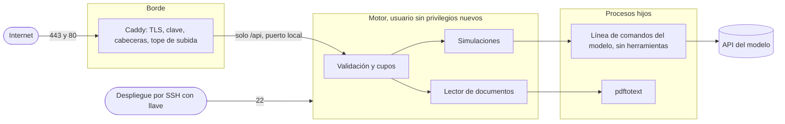

# 6. Seguridad

[Índice](README.md)

Qué puede salir mal, qué lo impide y qué queda sin cubrir. Este documento recoge la auditoría hecha
el 21 de noviembre de 2026 sobre el código y la configuración efectiva de la máquina, con pruebas en
local y una revisión independiente del cambio. No es una prueba de penetración ni una certificación.

## 6.1 Modelo de amenazas

**Qué se protege (activos).**

| Activo | Por qué importa |
|---|---|
| La disponibilidad del sitio | Una caída durante la presentación es el peor resultado posible |
| La suscripción del modelo | Cada llamada gasta el cupo de quien puso sus credenciales |
| Las credenciales del modelo y la llave de despliegue | Con ellas se gasta la cuenta o se toma la máquina |
| La máquina | Corre con un usuario que puede administrar el sistema |
| La integridad de los resultados | Un resultado alterado desacredita la herramienta |
| Lo que escriben quienes usan el sitio | Entra a un historial común |

**De quién (actores).**

- Público legítimo: muchas personas a la vez, sin mala intención, quizás todas desde la misma red.
- Curioso que prueba límites: tamaños máximos, textos enormes, archivos raros.
- Atacante sin cuenta: busca botar el sitio, gastar la suscripción o ejecutar código en la máquina.
- Otra página web: intenta usar el navegador de un visitante para llamar a la API.
- Quien escribe la propuesta: su texto llega al modelo y puede intentar dirigirlo.

**Fronteras de confianza y puntos de entrada.**

Todo lo que cruza de internet al motor es no confiable: el cuerpo de cada pedido, las cabeceras, el
archivo subido y el texto de la propuesta. También es no confiable lo que devuelve el modelo: se
acepta solo si calza con el esquema esperado.

## 6.2 Amenazas y controles

| ID | Amenaza | Control | Dónde | Estado |
|---|---|---|---|---|
| A-01 | Agotar la memoria lanzando muchas simulaciones grandes: cada lote es un proceso de unos 200 MB | C-01 reparto común de llamadas; C-02 cupos de simulaciones y de respuestas en cola; C-03 tope de memoria del servicio | `limites.py`, `__main__.py`, `infra/ph26-motor.service` | Cubierto y medido |
| A-02 | Gastar la suscripción con pedidos amplificados: texto enorme en cada llamada, agentes repetidos, lotes de una persona | C-04 validación de cada campo; el lote lo decide el servidor | `__main__._crear_corrida` | Cubierto |
| A-03 | Seguir gastando tras cerrar la pestaña | C-05 detención por abandono a los 90 segundos, revisada al empezar cada lote | `corridas._revisar_abandono` | Cubierto |
| A-04 | Retener hilos con conexiones lentas o calladas | C-06 tiempo de espera de 150 s por conexión, tope de 800 conexiones, tiempo de espera de cabeceras en el borde | `__main__.Manejador`, `__main__.Servidor`, `infra/Caddyfile` | Cubierto |
| A-05 | Ocupar todas las conexiones con flujos de eventos | C-07 tope de flujos por dirección y por simulación | `__main__._eventos` | Cubierto |
| A-06 | Archivo que se infla al abrirlo o que demora en convertirse | C-08 lectura con tope, páginas máximas, tiempo máximo y pocas conversiones a la vez | `documentos.py` | Cubierto |
| A-07 | Acumular memoria repitiendo simulaciones que salen de la caché | C-09 olvido de simulaciones terminadas y tope de las recordadas | `__main__.olvidar_corridas` | Cubierto |
| A-08 | Inyección en la consulta a la población por los filtros | C-10 los filtros se convierten a enteros dentro de rango antes de escribirse en la consulta | `sociedad.limpiar`, `poblacion.limpiar` | Cubierto |
| A-09 | Ejecución de comandos por el nombre del archivo o el texto | C-11 los procesos se lanzan con lista de argumentos, sin intérprete; el texto va por la entrada estándar; el archivo se guarda con nombre fijo | `motor.py`, `documentos.py` | Cubierto |
| A-10 | Lectura de archivos del servidor por una ruta manipulada | C-12 el identificador de una vista debe ser de 12 caracteres hexadecimales; no hay otra ruta que lea archivos por nombre | `historial.py` | Cubierto |
| A-11 | Que el texto de la propuesta dirija al modelo para hacer algo en la máquina | C-13 el modelo corre sin herramientas, sin servidores externos y sin configuración del proyecto; su salida se valida contra un esquema | `motor.ClaudeCodigo._llamar` | Cubierto |
| A-12 | Que el texto de la propuesta haga decir algo ofensivo a los agentes | Las frases se limitan a 160 caracteres y la interfaz las muestra como texto, sin interpretar | `motor.leer_voces`, frontend | Aceptado como riesgo, ver 6.6 |
| A-13 | Que otra página lance simulaciones desde el navegador de un visitante | C-14 sin permiso entre orígenes; política de contenido y prohibición de marcos | `__main__.py`, `infra/Caddyfile` | Cubierto |
| A-14 | Que un error revele detalles internos | C-15 mensajes genéricos hacia afuera, detalle solo en el registro | `__main__.py`, `corridas.py` | Cubierto |
| A-15 | Capturar el tráfico en tránsito | C-16 TLS; por la dirección numérica se redirige al dominio; cabecera de transporte estricto | `infra/Caddyfile` | Cubierto |
| A-16 | Que una falla en el lector de PDF o en el motor dé control de la máquina | C-17 el servicio no puede obtener privilegios nuevos ni escribir en el sistema | `infra/ph26-motor.service` | Mitigado |
| A-17 | Robo de las credenciales del modelo | Viven en un archivo de la máquina legible solo por el administrador, fuera del repositorio | `/etc/ph26/entorno` | Cubierto |
| A-18 | Acceso por SSH | Solo con llave; el acceso por contraseña está deshabilitado | Configuración de la máquina | Cubierto; el puerto está abierto a internet |
| A-19 | Que el motor quede expuesto sin pasar por el borde | El motor escucha solo en la interfaz local; el grupo de seguridad abre solo 22, 80 y 443 | `__main__.main`, `infra/main.tf` | Verificado desde afuera |
| A-20 | Dependencias vulnerables | El servidor importa solo la biblioteca estándar y DuckDB. El entorno instala además numpy, pandas, pyarrow y openpyxl para los scripts de datos, que no se auditaron. El frontend no tiene vulnerabilidades conocidas en producción | `backend/pyproject.toml`; `npm audit` del 21 de noviembre | Revisado en parte |

## 6.3 Controles por capa

### Borde: Caddy

- TLS con certificado automático. Lo que llega por la dirección numérica o por HTTP se redirige al
  dominio con HTTPS.
- Sin clave de acceso: el sitio está abierto a cualquiera.
- Cabeceras: transporte estricto por un año, sin detección de tipo, sin marcos, sin referente, y
  política de contenido que solo permite recursos del propio sitio.
- Cuerpo de hasta 26 MB; 15 segundos para enviar las cabeceras; conexiones ociosas hasta 3 minutos.
- El flujo de eventos se entrega sin acumular.

### Aplicación: el motor

- **Validación.** Cada campo de cada pedido tiene tipo y límite ([documento 5](05-api.md), sección
  5.4). Un pedido con codificación por trozos, con un tamaño negativo o no numérico, o que llega
  incompleto se rechaza. Sin tamaño declarado se trata como cuerpo vacío.
- **Admisión.** Tasas por dirección y cupos globales. Los cupos por dirección son holgados porque
  una sala entera puede salir por la misma; lo que protege a la máquina son los globales.
- **Aislamiento del modelo.** La línea de comandos se invoca sin herramientas (`--tools ""`), sin
  servidores externos (`--strict-mcp-config`), sin configuración (`--setting-sources ""`), sin
  guardar la sesión y en una carpeta vacía. Lo único que puede devolver es JSON que calce con el
  esquema: enteros de 1 a 7 y, para las frases, texto que se recorta.
- **Errores.** Hacia afuera, un mensaje para la persona; adentro, la traza en el registro.

### Sistema: el servicio

- Tope de memoria de 27 GB para el motor y sus hijos. Si se alcanza, el corte ocurre dentro del
  servicio: el servidor web y el acceso de administración siguen vivos.
- Los procesos del modelo se marcan como preferidos para ese corte. Perder uno es perder un lote,
  que se reintenta; perder el motor sería perder todas las simulaciones en curso.
- Sin privilegios nuevos, sistema de archivos del sistema en solo lectura, carpeta temporal propia,
  sin acceso a dispositivos ni a ajustes del núcleo.
- Reinicio automático a los 2 segundos si el proceso termina.

## 6.4 Hallazgos de la auditoría y su estado

Severidad según el efecto sobre los activos de 6.1.

| ID | Hallazgo | Severidad | Estado |
|---|---|---|---|
| H-01 | Cada simulación abría su propio grupo de 150 procesos, sin tope entre simulaciones: quince a la vez pedían más de 2.000 procesos en una máquina de 30 GB | Crítico | Corregido con C-01, C-02 y C-03 |
| H-02 | El texto de la propuesta no tenía largo máximo y viajaba completo en cada llamada | Alto | Corregido: 8.000 caracteres |
| H-03 | La lista de agentes aceptaba repetidos y el pedido podía fijar lotes de una persona, multiplicando las llamadas | Alto | Corregido: sin repetidos, lote del servidor |
| H-04 | Un archivo Word de 600 KB se expandía a cientos de MB en memoria; la salida de un PDF no tenía tope | Alto | Corregido con C-08 |
| H-05 | Una conexión que no enviaba nada retenía un hilo indefinidamente; un tamaño negativo dejaba al servidor leyendo hasta el cierre | Alto | Corregido con C-06 |
| H-06 | Una simulación seguía gastando modelo después de cerrada la pestaña | Medio | Corregido con C-05 |
| H-07 | Las simulaciones terminadas no salían nunca de la memoria | Medio | Corregido con C-09 |
| H-08 | La API permitía pedidos desde cualquier origen | Medio | Corregido con C-14 |
| H-09 | Los errores devolvían el tipo y el texto de la excepción | Medio | Corregido con C-15 |
| H-10 | Por la dirección numérica el sitio respondía sin cifrar, con la clave de acceso en claro | Medio | Corregido con C-16 |
| H-11 | Un fallo al escribir la caché abortaba la simulación | Medio | Corregido: se avisa en el registro y se sigue |
| H-12 | Los reintentos de un lote eran inmediatos, lo que empeora un límite del proveedor | Bajo | Corregido: espera creciente |
| H-13 | El servicio corría con un usuario que puede volverse administrador | Medio | Mitigado con C-17 |
| H-14 | Sin cabeceras de seguridad ni tope de subida en el borde | Bajo | Corregido |
| H-15 | La configuración del servidor web y del servicio no estaba versionada | Bajo | Corregido: `infra/Caddyfile`, `infra/ph26-motor.service` |

## 6.5 Verificación

| Qué | Cómo | Resultado |
|---|---|---|
| Pedidos mal formados y abusivos | 25 casos contra el servidor real en local, con un motor falso que no gasta: JSON inválido, tipos incorrectos, textos de 100.000 caracteres, 50.000 agentes repetidos, inyección en filtros, rutas manipuladas, tamaños negativos, cuerpos incompletos, ráfaga de 80 simulaciones | 24 respondidos como se esperaba. El restante, un pedido de 5 MB, se rechaza cortando la conexión en vez de con mensaje |
| Archivo que se infla | Un Word de 640 KB que se expande a 330 MB | Leído con tope en 0,1 s; hay prueba automática |
| Reparto y cupos | Pruebas automáticas en `backend/tests/test_limites.py`: tope, equidad, prioridad, errores, descarte, tasas | 11 pruebas pasan |
| Detención por abandono | Simulación de 2.000 agentes sin nadie mirando, con el tiempo reducido | Se detuvo tras 80 de 200 llamadas |
| Inundación de flujos | 45 flujos sobre una misma simulación | 30 aceptados, 15 rechazados |
| Política de contenido | Recorrido completo del sitio en un navegador a través de la misma versión del servidor web | Sin errores de política ni de consola |
| Exposición | Desde afuera: por la dirección numérica redirige y el puerto del motor está cerrado; mientras el sitio tuvo clave, sin ella respondía 401 | Verificado el 21 de noviembre |
| Servicio endurecido | Simulaciones reales de 1.000 y 10.000 agentes en producción | Completas; ver [documento 7](07-capacidad-y-escalado.md) |
| Revisión independiente | Un revisor sin contexto previo leyó el cambio y escribió un programa de reproducción | 12 hallazgos; corregidos los que afectaban disponibilidad y despliegue |

No se hicieron pruebas de carga ni de fuerza contra producción.

## 6.6 Riesgo residual

| ID | Riesgo | Por qué queda | Qué lo reduce |
|---|---|---|---|
| RS-01 | Una sola dirección puede ocupar hasta 12 simulaciones a la vez y buena parte de la cola | Los cupos por dirección son holgados para no dejar fuera a una sala que comparte red | Bajar `CORRIDAS_POR_DIRECCION` y `RESPUESTAS_EN_COLA` al abrir sin clave |
| RS-02 | El historial es común: lo que escribe cualquiera lo ven todos, incluido algo ofensivo | No hay cuentas | `HISTORIAL_OCULTO=1` mientras el sitio esté abierto |
| RS-03 | Una propuesta puede hacer que los agentes digan frases fuera de lugar | Es inherente a mostrar texto generado | Las frases son cortas y no se interpretan; se puede ocultar la capa de frases en la interfaz |
| RS-04 | Repetir simulaciones que salen de la caché llena el cupo de 200 vistas y desplaza las del resto | El historial no distingue de quién es cada simulación | Tasa de 60 simulaciones por minuto por dirección |
| RS-05 | El puerto de administración está abierto a internet | El despliegue continuo entra desde direcciones que cambian | Solo acepta llave; se puede limitar a un rango si se despliega a mano |
| RS-06 | Un ataque distribuido de muchas direcciones no se filtra en el borde | No hay servicio de protección delante de la máquina | Poner el dominio detrás de un proxy con protección; los cupos globales mantienen vivo el proceso |
| RS-07 | El usuario del servicio puede administrar la máquina si se obtiene una sesión por otra vía | Es el usuario por defecto de la imagen | El servicio no puede escalar privilegios; separar a un usuario propio sin permisos de administración |
| RS-08 | No hay respaldo de la caché ni del historial | Fuera del plazo del proyecto | Copia nocturna a almacenamiento externo |
| RS-09 | Un pedido JSON de más de 1,5 MB se rechaza cortando la conexión | El servidor no lee cuerpos grandes que va a rechazar | El borde responde con error; el mensaje al usuario es genérico |

## 6.7 Lista para el sitio abierto al público

1. Decidir los topes para ese rato y ponerlos en `/etc/ph26/entorno`
   ([documento 8](08-operacion.md), sección 8.5).
2. Poner `HISTORIAL_OCULTO=1` si no se quiere que el público vea lo que escriben otros.
3. Reiniciar el motor y comprobar `/api/estado`.
4. No desplegar cambios del backend mientras esté abierto: cada reinicio corta las simulaciones en
   curso.
