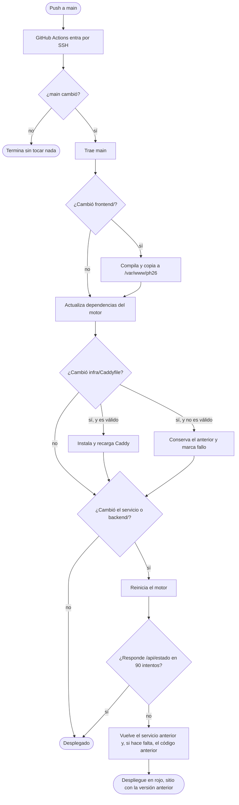

# 8. Operación

[Índice](README.md)

Cómo se levanta, se despliega, se configura y se repara. Para crear la máquina desde cero, ver
`infra/README.md`.

## 8.1 Levantar en local

```sh
./iniciar.sh                 # motor en el puerto 8787 y frontend con Vite
```

O solo el motor:

```sh
cd backend
uv run python -m servidor                 # elige el mejor motor disponible
PUERTO=8797 MOTOR=claude uv run python -m servidor
```

El motor se elige solo, en este orden, o se fuerza con `MOTOR`:

| Motor | Condición | Uso |
|---|---|---|
| `local` | `LLAMA_URL` definida | Modelo local en la GPU; una persona por llamada; sin frases. No redacta: pedir iteraciones o subir un documento largo termina en error |
| `api` | `ANTHROPIC_API_KEY` y el paquete `anthropic` | API del proveedor, sin proceso por llamada |
| `claude` | La línea de comandos `claude` con sesión | El de producción; un proceso por lote |

Sin ninguno el servidor no arranca y lo dice. Sin DuckDB o sin la tabla de agentes usa un archivo
fijo de 2.000 personas.

Pruebas:

```sh
cd backend
uv run python -m unittest tests.test_limites tests.test_historial tests.test_sociedad tests.test_reparto
```

## 8.2 Despliegue

Cada push a `main` ejecuta `.github/workflows/desplegar.yml`, que entra a la máquina por SSH y corre
`infra/desplegar.sh`.



Lo que hay que saber:

- **Un cambio que no toca `backend/` ni `infra/ph26-motor.service` no reinicia el motor**, así que
  no corta simulaciones en curso.
- **Un cambio en `backend/` o en el servicio sí lo reinicia** y las simulaciones en curso se pierden.
  Tras reiniciar se comprueba `/api/estado` hasta 90 veces, una por segundo. No desplegar
  backend durante una presentación.
- **Si el frontend no compila**, el despliegue queda en rojo y el sitio sigue con lo anterior.
- **Si el motor nuevo no responde**, el script restaura el servicio anterior; si tampoco responde,
  restaura el código anterior del backend. El despliegue queda en rojo para que alguien lo mire.
- **Un cambio en `infra/desplegar.sh` vale recién en el despliegue siguiente**, porque el que corre
  es la copia anterior. Después de tocarlo, desplegar a mano una vez:

  ```sh
  FORZAR=1 bash ~/ph26/infra/desplegar.sh
  ```

Comandos útiles desde un computador con acceso:

```sh
gh run list --workflow desplegar.yml      # qué se desplegó y si quedó en verde
gh workflow run desplegar.yml             # desplegar a mano
```

## 8.3 Configuración

Todo se ajusta con variables de entorno. En producción, los valores fijos están en
`infra/ph26-motor.service` y los que se cambian sin desplegar, en `/etc/ph26/entorno` de la máquina
(los segundos pisan a los primeros). Después de editar ese archivo: `sudo systemctl restart ph26-motor`.

### Motor y método

| Variable | Por defecto | En producción | Qué hace |
|---|---|---|---|
| `MOTOR` | El mejor disponible | `claude` | Fuerza un motor: `local`, `api` o `claude` |
| `CLAUDE_TOKENS` | Vacío | Definido en la máquina | Sesiones del modelo, separadas por coma; las llamadas se reparten entre ellas |
| `LOTE` | 10 | 10 | Personas por llamada al modelo |
| `PERFIL` | `tematico` | `tematico` | Cuánto del perfil lee el modelo: `tematico`, `nucleo` o `completo` |
| `PUERTO` | 8787 | 8787 | Puerto local del motor |
| `ABIERTO` | Vacío | Vacío | Si se define, el motor escucha en todas las interfaces. No usar en producción |
| `LLAMA_URL`, `TEMPERATURA` | Vacío, 1.0 | No se usan | Modelo local |

### Topes

| Variable | Por defecto | En producción | Qué limita |
|---|---|---|---|
| `LLAMADAS` | El valor de `CONCURRENCIA`, o 30 | 120 | Llamadas al modelo a la vez, sumando todas las simulaciones |
| `MAXIMO_MUESTRA` | 10.000 | 10.000 | Agentes por simulación |
| `RESPUESTAS_POR_CORRIDA` | 80.000 | 80.000 | Agentes por (variantes más iteraciones) |
| `RESPUESTAS_EN_COLA` | 200.000 | 200.000 | Respuestas pendientes entre todas las simulaciones |
| `CORRIDAS_A_LA_VEZ` | 40 | 40 | Simulaciones en curso |
| `CORRIDAS_POR_DIRECCION` | 12 | 12 | Simulaciones en curso desde una misma dirección |
| `CORRIDAS_POR_MINUTO` | 60 | 60 | Simulaciones nuevas por minuto y dirección |
| `DOCUMENTOS_POR_MINUTO` | 30 | 30 | Documentos por minuto y dirección |
| `MUESTRAS_POR_MINUTO` | 600 | 600 | Cambios de filtro por minuto y dirección |
| `PEDIDOS_POR_MINUTO` | 3.000 | 3.000 | Pedidos de cualquier tipo por minuto y dirección |
| `DOCUMENTOS_A_LA_VEZ` | 3 | 3 | Documentos leyéndose y resumiéndose |
| `MUESTRAS_EN_ESPERA` | 12 | 12 | Muestras nuevas esperando la tabla |
| `CONEXIONES` | 800 | 800 | Conexiones abiertas |
| `FLUJOS_POR_DIRECCION` | 60 | 60 | Flujos de eventos abiertos desde una dirección |
| `FLUJOS_POR_CORRIDA` | 30 | 30 | Flujos de eventos sobre una misma simulación |
| `CORRIDAS_RECORDADAS` | 60 | 60 | Simulaciones terminadas que quedan en memoria |
| `ABANDONO` | 90 | 90 | Segundos sin nadie mirando antes de detener una simulación |
| `HISTORIAL_OCULTO` | Vacío | Vacío | Con `1`, el historial se guarda pero no se muestra |

### Archivos de la máquina que no están en el repositorio

| Archivo | Contenido | Permisos |
|---|---|---|
| `/etc/ph26/entorno` | `CLAUDE_TOKENS` y los topes que se quieran cambiar | Solo el administrador |
| `/etc/ph26/acceso.caddy` | Usuario y clave de acceso al sitio. Si no existe, el sitio queda abierto | |

## 8.4 Salud y registros

No hay monitoreo ni alertas automáticas: durante el evento alguien del equipo mira. Lo que hay para
mirar:

| Qué | Cómo | Qué es normal |
|---|---|---|
| El motor responde | `curl -s localhost:8787/api/estado` en la máquina | 200 en milisegundos |
| Servicios | `systemctl is-active ph26-motor caddy` | `active` los dos |
| Registro del motor | `journalctl -u ph26-motor -f` | Solo pedidos con error (4xx y 5xx), avisos de lotes fallidos y simulaciones detenidas por abandono |
| Memoria del servicio | `systemctl show ph26-motor -p MemoryCurrent -p MemoryPeak` | Bajo 20 GB con carga |
| Procesos del modelo | `pgrep -c -f "claude -p"` | Hasta 120 |
| Carga de la máquina | `uptime` | Hasta 16 |
| Disco | `df -h /` | Bajo 80 % |
| Cortes por memoria | `journalctl -k \| grep -i "out of memory"` | Ninguno |

El motor escribe en el registro solo lo que importa: pedidos que terminan en error, la traza de un
error interno, cada lote que falla tres veces con su causa, y cada simulación que se detiene por
abandono o que falla. No registra el contenido de las propuestas.

## 8.5 Tareas frecuentes

**Abrir el sitio al público.**

```sh
# 1. Topes para ese rato (opcional) y, si se quiere, ocultar el historial
sudo nano /etc/ph26/entorno
sudo systemctl restart ph26-motor
curl -s localhost:8787/api/estado | head -c 200

# 2. Quitar la clave
sudo mv /etc/ph26/acceso.caddy /etc/ph26/acceso.caddy.guardado
sudo systemctl reload caddy
```

**Volver a cerrarlo.**

```sh
sudo mv /etc/ph26/acceso.caddy.guardado /etc/ph26/acceso.caddy
sudo systemctl reload caddy
```

**Agregar una cuenta del modelo.** Agregar su sesión a `CLAUDE_TOKENS` en `/etc/ph26/entorno`,
separada por coma, y reiniciar el motor.

**Vaciar la caché de respuestas.** Detener el motor, borrar `backend/data/cache/respuestas.jsonl`,
iniciar el motor. Cada pregunta vuelve a gastar modelo.

**Desplegar a mano.** `FORZAR=1 bash ~/ph26/infra/desplegar.sh` en la máquina. Recompila el frontend
y reinicia el motor aunque no haya cambios.

## 8.6 Qué hacer ante un incidente

| Síntoma | Causa probable | Qué hacer |
|---|---|---|
| El sitio no carga | Caddy detenido, o el dominio no apunta a la máquina | `systemctl status caddy`; comprobar el registro del dominio. La máquina no tiene dirección fija: si se detuvo y volvió a partir, cambió |
| La interfaz dice "Demostración sin motor" | El motor no responde | `systemctl status ph26-motor` y `journalctl -u ph26-motor -n 50`. Se reinicia solo a los 2 s; si no parte, la causa está en el registro |
| El motor no parte tras un despliegue | Cambió una firma en `backend/scripts/` que usa `metodo.py`, o falta una dependencia | El despliegue ya debió volver a la versión anterior. Si no: `git -C ~/ph26 log -3`, volver al commit anterior del backend y reiniciar |
| "Hay muchas simulaciones en curso" | Se llenó un cupo | Es el comportamiento esperado. Mirar `pgrep -c -f "claude -p"`; si hace falta, subir `RESPUESTAS_EN_COLA` o bajar `MAXIMO_MUESTRA` |
| Muchos avisos de "un grupo no alcanzó a responder" | El proveedor está limitando la cuenta | Agregar una cuenta a `CLAUDE_TOKENS` o bajar `LLAMADAS` |
| Las simulaciones van lentas para todos | Varias grandes a la vez: la capacidad se reparte | Esperado ([documento 7](07-capacidad-y-escalado.md), sección 7.5). Bajar `MAXIMO_MUESTRA` mientras dure |
| La máquina no responde ni por SSH | Memoria agotada fuera del servicio, o falla de la instancia | Reiniciar la instancia desde la consola del proveedor. El tope de memoria del servicio existe para que esto no ocurra |
| Las simulaciones se cortan solas | Un despliegue del backend reinició el motor, o nadie las miraba por 90 s | Ver `gh run list`; no desplegar backend durante la presentación |
| Un documento no se lee | PDF escaneado sin texto, protegido o demasiado largo | Subirlo como texto |
| Resultados raros tras cambiar el método | La caché se invalida sola si cambian instrucciones, encuesta o filtro; no si cambian los datos de los agentes | Vaciar la caché |

## 8.7 Recuperación ante desastre

| Pérdida | Cómo se recupera | Tiempo |
|---|---|---|
| El proceso del motor | Reinicio automático | Segundos; se pierden las simulaciones en curso |
| La máquina | `terraform apply` en `infra/`, poner los dos archivos de `/etc/ph26` y apuntar el dominio a la dirección nueva | Unos 15 minutos, no ensayado |
| La caché | No se recupera; se vuelve a preguntar | |
| El historial | No se recupera | |
| La tabla de agentes | Está en el repositorio | |

No hay respaldos (RT-06) y la recuperación de la máquina no se ha ensayado de punta a punta.
