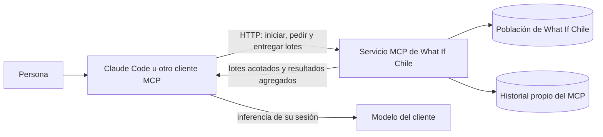

# 2. Arquitectura

[Índice](README.md)

## 2.1 Responsabilidades

| Parte | Responsabilidad |
|---|---|
| Cliente | Confirma el gasto de su sesión con la persona. Ejecuta la inferencia y devuelve notas, voces o reformulaciones según el esquema del lote |
| Servidor MCP | Selecciona la muestra, administra lotes, valida salidas, arma variantes y consolida resultados |
| Backend compartido como código | Provee la población y el muestreo, la encuesta, la lógica de corridas y el formato de historial |
| Web de producción | Ejecuta su propio motor y lee el historial de su proceso |

La orquestación viaja por llamadas de herramientas MCP. El cliente pide trabajo y lo entrega en llamadas sucesivas. La sesión del cliente elige y usa su modelo. El servidor aislado puede arrancar en una máquina sin Claude Code instalado.

## 2.2 Módulos

| Módulo | Responsabilidad |
|---|---|
| [`__main__.py`](../../mcp/whatif_mcp/__main__.py) | Arranque con Uvicorn, ruta de salud y modo de prueba con una web local |
| [`protocolo.py`](../../mcp/whatif_mcp/protocolo.py) | Transporte, herramientas, esquemas de entrada e instrucciones al cliente |
| [`servicio.py`](../../mcp/whatif_mcp/servicio.py) | Admisión, deduplicación de inicios, acceso a corridas y resultados agregados |
| [`motor.py`](../../mcp/whatif_mcp/motor.py) | Prepara el contenido de cada lote, espera la respuesta del cliente y valida su estructura y contenido |
| [`runtime.py`](../../mcp/whatif_mcp/runtime.py) | Población, corridas en memoria e historial del servicio aislado |

`CorridaMCP` reutiliza el ciclo de la [corrida del backend](../../backend/servidor/corridas.py). Tiene un reparto propio de hilos para que, en el modo `--con-web`, los lotes que esperan al cliente no ocupen los trabajadores del motor web. Las respuestas declaradas por el cliente quedan fuera de la caché de respuestas web.

## 2.3 Despliegue e historial

El modo aislado ejecuta un proceso con un trabajador HTTP y su propio almacenamiento. Los lotes, el avance en curso y los recibos viven en memoria. Reiniciar interrumpe corridas activas. El almacenamiento conserva las terminadas según las reglas del [historial](04-privacidad-y-datos.md#43-persistencia). El despliegue está diseñado para una instancia por volumen de historial.

El modo local `--con-web` arranca la API web dentro del mismo proceso y permite reabrir una corrida del MCP desde la interfaz de desarrollo. La web publicada mantiene el historial en memoria por proceso y su API carece de una operación de importación de corridas. Compartir el formato de archivo permite reutilizar el código y la vista, pero no agrega al historial público las corridas del servicio aislado.
