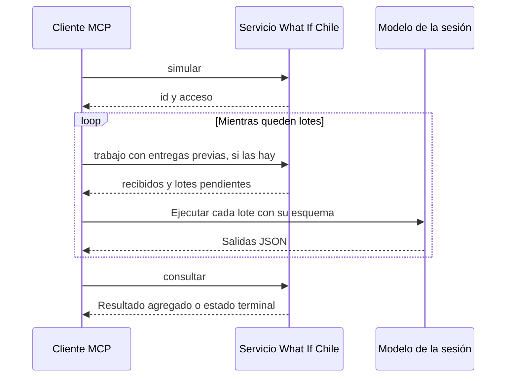

# 3. Protocolo y flujos

[Índice](README.md)

## 3.1 Herramientas

El endpoint `/mcp` usa MCP Streamable HTTP. Inicializa la sesión del protocolo, descubre herramientas con `tools/list` y llama con `tools/call`. El esquema que publica la instancia en `tools/list` es el contrato de su versión. `GET /healthz` es una ruta operativa local y el proxy HTTPS solo publica `/mcp`.

| Herramienta | Argumentos | Resultado |
|---|---|---|
| `estado` | Objeto vacío | Preguntas y escalas, filtros disponibles, topes vigentes y visibilidad del historial |
| `simular` | `solicitud`, `propuestas`, `publicar_en_historial`, `filtros?`, `iteraciones?` | ID y acceso de la corrida, tamaño efectivo de la muestra y variantes pedidas |
| `trabajo` | `id`, `acceso`, `entregas?` | Lotes que quedan para el cliente, IDs recibidos y estado |
| `consultar` | `id`, `acceso` | Progreso o resultado agregado con metadatos del historial |
| `cancelar` | `id`, `acceso` | `cancelando` o estado actual si la corrida terminó |

Esta llamada a `simular` solicita diez agentes para una variante.

```json
{
  "solicitud": "adfc12fe-7fca-4cde-96bf-25e0120790db",
  "propuestas": [{"texto": "Extender el subsidio al transporte rural."}],
  "publicar_en_historial": true,
  "filtros": {"tamano": 10},
  "iteraciones": 0
}
```

Usa un UUID v4 nuevo por corrida y consérvalo para reintentar esa misma solicitud. Cada variante necesita `texto`, `documento` o ambos. El texto se admite hasta 8.000 caracteres. El documento se pasa con `nombre`, `titulo` opcional y `texto` ya preparado de hasta 10.500 caracteres. `filtros` también admite `edadMin`, `edadMax`, `reduccion` y `elegidos`. Consulta los códigos de opciones con `estado`. Se admiten hasta ocho variantes en total, contando las iteraciones, y hasta tres iteraciones. El nombre `publicar_en_historial` autoriza el guardado. La visibilidad efectiva depende del modo del servidor.

## 3.2 Ciclo de ejecución



Cada lote incluye `lote`, `tipo`, `entrada` y `salida`. En el lote recibido, `salida` es el esquema JSON. En el argumento `entregas` de la llamada siguiente, `salida` es el objeto generado por el modelo.

| Tipo | Forma de la salida |
|---|---|
| `encuesta` | `{"r":[{"i":0,"p":[6,5,4,5,3]}]}`. Una fila por persona, con notas enteras del 1 al 7 en el orden del lote |
| `voces` | `{"r":[{"i":0,"f":"Me facilitaría llegar al trabajo."}]}`. Una frase por persona, de hasta 160 caracteres |
| `redaccion` | `{"titulo":"Subsidio rural","texto":"Extender la cobertura a zonas rurales.","cambio":"Amplía la cobertura."}` |

Para entregar, llama a `trabajo` con `id` y `acceso`, más `entregas: [{"lote": "...", "salida": {...}}]`. Usa el identificador recibido para vincular la salida con su lote. El cliente no debe ejecutar dos veces un lote que ya tiene en curso si vuelve a aparecer en otra respuesta. Una salida inválida no consume el lote y se puede corregir. Reenviar una salida aceptada mientras la corrida está activa no duplica sus respuestas.

Si `lotes` llega vacío y la corrida sigue activa, espera unos segundos y vuelve a llamar a `trabajo`. Esta llamada mantiene el contacto con la corrida. Tras una respuesta perdida de `simular`, reenvía los mismos argumentos con el mismo UUID. El recibo en memoria dura una hora. Reusar el UUID con otros argumentos devuelve un error. Si el servidor se reinició, consulta la corrida anterior si tienes su ID y acceso.

## 3.3 Estados y resultados

| Estado | Significado |
|---|---|
| `preparando` | Ya se está procesando el mismo inicio y todavía no hay ID que devolver |
| `en_curso`, `guardando` | Se están ejecutando lotes o escribiendo el historial |
| `cancelando` | Se solicitó detener la corrida. El cliente puede detener sus propios subagentes |
| `completa`, `parcial` | La corrida tiene resultados. La parcial contiene solo las respuestas obtenidas |
| `cancelada` | Se detuvo por petición o por vencimiento. Tras perder el estado activo, una corrida cancelada con resumen puede consultarse como parcial |
| `sin_resultados` | La corrida terminó sin una respuesta aprovechable |
| `historial_no_disponible` | La corrida en memoria tiene respuestas, pero no se encuentra su entrada del historial |
| `no_disponible` | No se encontró una corrida en memoria ni un resumen consultable para ese ID |

El resultado conserva los conteos de la primera pregunta. Notas de 1 a 3 son `contra`, 4 es `indecisa` y 5 a 7 son `favor`. Si está disponible la vista o los eventos de la corrida, también devuelve conteos por nota y por pregunta. Los errores de validación y de acceso se devuelven como errores de herramienta y pueden venir en una respuesta HTTP exitosa. Comprueba el indicador `isError` antes de leer el resultado.
